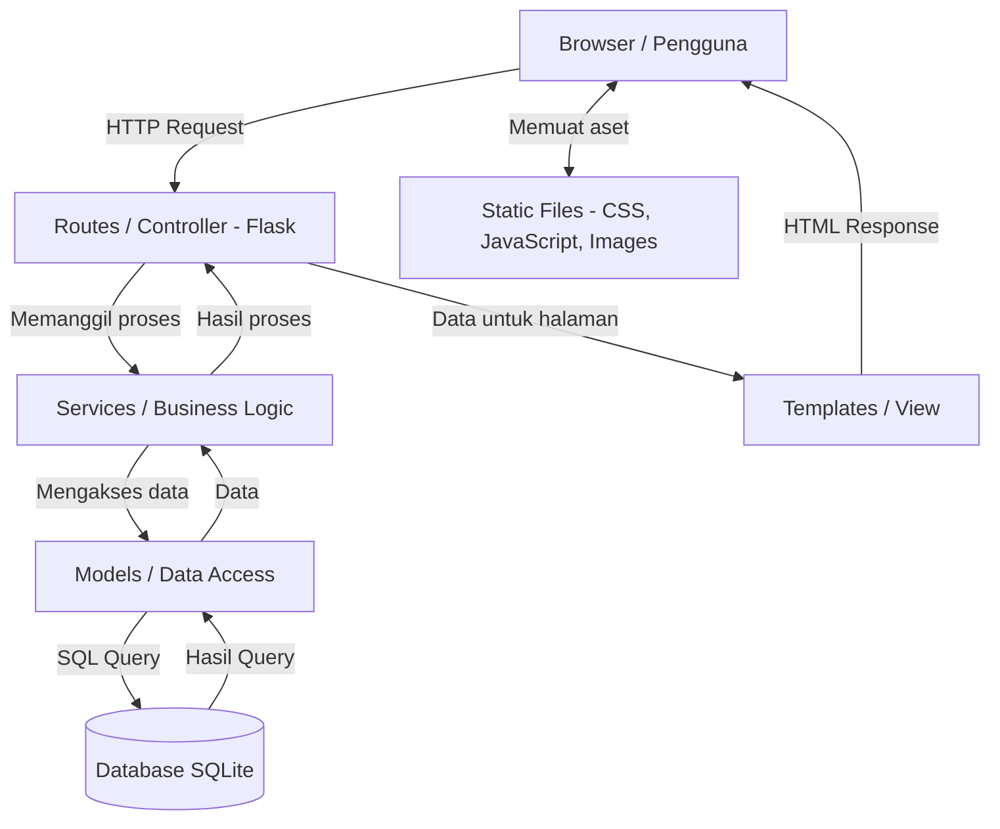

# Arsitektur Sistem
## Sistem Informasi Pengelolaan Kontrakan

## 1. Gambaran Umum

Sistem Informasi Pengelolaan Kontrakan menggunakan arsitektur berlapis (layered architecture). Setiap lapisan memiliki tanggung jawab masing-masing agar kode lebih terstruktur, mudah dipelihara, dan dapat dikembangkan.

Teknologi yang digunakan:
- Python
- Flask
- SQLite
- HTML, CSS, dan JavaScript

## 2. Diagram Arsitektur



## 3. Penjelasan Lapisan

### 3.1 Browser / Pengguna
Pengguna berinteraksi dengan sistem melalui browser. Browser mengirimkan HTTP Request dan menerima halaman HTML sebagai respons.

### 3.2 Routes / Controller
Lapisan ini menerima request dari browser, memproses parameter request, memanggil service yang sesuai, dan menentukan response yang diberikan kepada pengguna.

### 3.3 Services / Business Logic
Lapisan ini menangani aturan dan proses bisnis aplikasi, seperti autentikasi pengguna, pengelolaan kamar, dan pengelolaan data penyewa.

### 3.4 Models / Data Access
Lapisan ini bertanggung jawab terhadap akses database SQLite. Seluruh operasi SQL, termasuk membaca, menambahkan, mengubah, dan menghapus data, dilakukan melalui lapisan ini.

### 3.5 Database SQLite
SQLite digunakan untuk menyimpan data aplikasi secara persisten. Struktur database mengacu pada `docs/desain/schema.sql`.

### 3.6 Templates / View
Lapisan ini berisi template HTML yang digunakan untuk menampilkan halaman aplikasi kepada pengguna.

### 3.7 Static Files
Folder ini menyimpan aset antarmuka seperti CSS, JavaScript, dan gambar.

## 4. Struktur Folder Proyek

```text
rpl-sistem-informasi-kontrakan/
├── app.py
├── routes.py
├── services.py
├── models.py
├── templates/
├── static/
│   ├── css/
│   ├── js/
│   └── img/
├── tests/
├── docs/
│   ├── elisitasi/
│   │   ├── catatan-wawancara.md
│   │   ├── pedoman-wawancara.md
│   │   └── user-story.md
│   ├── desain/
│   │   ├── schema.sql
│   │   ├── erd.mmd
│   │   ├── erd.png
│   │   ├── kamus-data.md
│   │   └── arsitektur.md
│   ├── kesepakatan-tim.md
│   ├── product-backlog.md
│   └── srs.md
├── .github/
├── PRD.md
├── aturan-proyek.md
├── jurnal-vibe-coding.md
└── README.md
```

## 5. Tanggung Jawab File dan Folder

| File / Folder | Tanggung Jawab |
|---|---|
| `app.py` | Inisialisasi dan konfigurasi aplikasi Flask |
| `routes.py` | Mengatur endpoint dan HTTP Request |
| `services.py` | Menjalankan proses dan aturan bisnis |
| `models.py` | Mengelola seluruh akses database SQLite |
| `templates/` | Menyimpan halaman HTML |
| `static/` | Menyimpan CSS, JavaScript, dan gambar |
| `tests/` | Menyimpan pengujian aplikasi |
| `docs/desain/` | Menyimpan dokumentasi desain dan database |
| `.github/` | Menyimpan konfigurasi GitHub |

## 6. Aturan Akses Database

1. Hanya `models.py` yang diperbolehkan mengakses database SQLite secara langsung.
2. Routes tidak boleh menjalankan query SQL secara langsung.
3. Services memanggil fungsi pada models untuk membaca atau mengubah data.
4. Struktur database harus mengikuti `docs/desain/schema.sql`.
5. Setiap perubahan struktur database harus disertai pengujian yang sesuai.

## 7. Urutan Pengembangan Modul Sprint 1

Berdasarkan Product Backlog Sprint 1, urutan pengembangan modul direncanakan sebagai berikut:

### 7.1 Modul Autentikasi
Mengacu pada:
- KF-01: Login
- KNF-04: Pembatasan akses jika belum login

### 7.2 Modul Data Kamar
Mengacu pada:
- KF-02: Menambahkan data kamar
- KF-03: Menampilkan data kamar

### 7.3 Modul Data Penyewa
Mengacu pada:
- KF-06: Menambahkan dan mengubah data penyewa

### 7.4 Modul Persistensi Data dan Pengujian
Mengacu pada:
- KNF-03: Persistensi data
- Pengujian fungsi dan integrasi modul Sprint 1

Urutan tersebut merupakan rencana pengembangan berdasarkan prioritas Product Backlog Sprint 1, bukan implementasi yang sudah selesai.

## 8. Status Implementasi

Dokumen ini merupakan rancangan arsitektur. Pada saat dokumentasi dibuat, struktur database dan pengujian skema telah tersedia, sedangkan implementasi aplikasi Flask dan pembagian kode ke dalam routes, services, dan models masih menjadi pekerjaan pengembangan berikutnya.

Perintah inisialisasi database akan ditetapkan setelah fungsi inisialisasi tersedia pada implementasi aplikasi.

## 9. Dokumen Desain dan Pengujian

Dokumen desain yang menjadi acuan pengembangan sistem meliputi:

| Dokumen | Fungsi |
|---|---|
| `docs/srs.md` | Menjelaskan kebutuhan fungsional dan nonfungsional sistem |
| `docs/desain/erd.mmd` | Menjelaskan hubungan antarentitas database |
| `docs/desain/erd.png` | Visualisasi ERD |
| `docs/desain/kamus-data.md` | Menjelaskan atribut, tipe data, dan aturan integritas |
| `docs/desain/normalisasi.md` | Menjelaskan proses normalisasi database |
| `docs/desain/schema.sql` | Menjadi acuan struktur database SQLite |
| `docs/desain/arsitektur.md` | Menjelaskan pembagian lapisan aplikasi |

Skrip pengujian rancangan database disimpan pada folder `tests/`:

- `cek_skema.py`
- `cek_skema_lanjutan.py`
- `cek_validasi_telepon.py`

Setiap perubahan pada struktur database harus diperiksa kesesuaiannya dengan SRS, ERD, kamus data, dan hasil pengujian.
